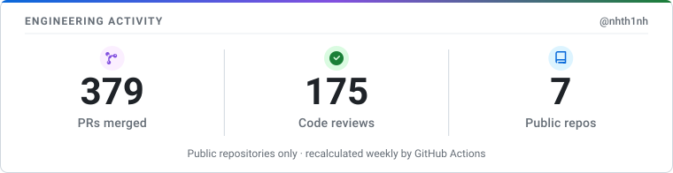
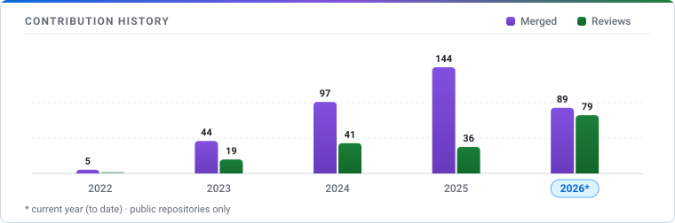

# Nguyen Hung Thinh ([@nhth1nh](https://github.com/nhth1nh))

**Software Engineer** — Enterprise Java, Jakarta EE, Spring Boot & AI Engineering (LangChain4j, RAG, Guardrails)

Formerly active on Enterprise Open Source as **@nhthinh-axonivy**

[Website / CV](https://nhth1nh.github.io/my-cv/) · [LinkedIn](https://www.linkedin.com/in/nhth1nh/) · [Email](mailto:nht.8299@gmail.com)

### Tech Stack & Core Tools

<!-- ACTIVITY:START -->
<picture>
  <source media="(prefers-color-scheme: dark)" srcset="activity-dark.svg">
  
</picture>
<!-- ACTIVITY:END -->

## What I Build

> *I bridge enterprise software engineering with modern AI — turning complex platforms and LLMs into secure, observable, production-grade systems.*

#### 🛡️ Safe & Trustworthy AI Applications
- **Focus:** Architecting enterprise AI assistants and LLM pipelines that protect sensitive company data, defend against prompt-injection/jailbreaks, and emit full execution traces for production auditability.
- **Key capabilities:** PII redaction & input/output guardrails, RAG (document retrieval), and real-time LLM observability.
- **Technologies:** `LangChain4j` · `Azure OpenAI` · `Ollama` · `OpenTelemetry` · `Arize Phoenix`

#### 🏛️ Mission-Critical Enterprise Platforms
- **Focus:** Engineering and modernizing core backend systems and enterprise web portals that handle complex workflows, cross-version backward compatibility, and large-scale platform migrations.
- **Key capabilities:** Legacy-to-modern migrations (Jakarta EE / PrimeFaces), cross-version URL link resolution, role-based access control, and REST APIs.
- **Technologies:** `Java` · `Spring Boot` · `Jakarta EE` · `PrimeFaces` · `PostgreSQL` · `REST APIs`

#### ⚡ Workflow Automation & Delivery Infrastructure
- **Focus:** Stabilizing CI/CD release pipelines, eliminating flaky UI/integration tests, and building developer tooling that accelerates continuous delivery across teams.
- **Key capabilities:** Automated regression testing, containerized CI/CD pipelines, and developer productivity tools.
- **Technologies:** `Docker` · `GitHub Actions` · `Jenkins` · `Selenide` · `Maven`

## Open-Source Highlights

### Community Upstream ([LangChain4j](https://github.com/langchain4j/langchain4j))
- **Observability API**: Added [`guardrailName()` on `GuardrailExecutedEvent`](https://github.com/langchain4j/langchain4j/pull/4940) to enable granular tracing, logging, and evaluation in LLM guardrail pipelines.
- **Azure OpenAI Resilience**: Fixed `NoClassDefFoundError` via lazy `ServiceLoader` discovery ([PR #5355](https://github.com/langchain4j/langchain4j/pull/5355)), allowing custom HTTP client providers without forcing Netty onto the classpath.
- **LLM & Ollama Provider Integrations**: Local inference workflows, structured JSON extraction, and local LLM runtime support for Java applications.

### Commercial & Enterprise Open Source ([Axon Ivy Market](https://github.com/axonivy-market))
- **[axonivy-market/portal](https://github.com/axonivy-market/portal)**: Over 330+ merged PRs spanning enterprise dashboard modernization, cross-version URL link resolution, security hardening (XSS, access control, file upload filters), Jackson 3 migration, and PrimeFaces 15 / Jakarta EE 11 platform upgrades.
- **[axonivy-market/smart-workflow](https://github.com/axonivy-market/smart-workflow)**: Architected the AI guardrail framework (PII masking, prompt-injection defense, collector/adapter architecture), observability tracing, and agentic workflow orchestration.

## Repository Breakdown

<!-- OSS:START -->
| Repository | Merged | Reviewed |
| :--- | ---: | ---: |
| [portal](https://github.com/axonivy-market/portal) | 361 | 166 |
| [mobileapp](https://github.com/axonivy-market/mobileapp) | 25 | 17 |
| [smart-workflow](https://github.com/axonivy-market/smart-workflow) | 11 | 9 |
| **[langchain4j](https://github.com/langchain4j/langchain4j)** ★13.4k | 2 | 1 |
| [vscode-designer](https://github.com/axonivy/vscode-designer) | 1 | 1 |
| [ai-assistant](https://github.com/axonivy-market/ai-assistant) | 1 | 0 |
| [axonivy-express](https://github.com/axonivy-market/axonivy-express) | 1 | 0 |

402 merged · 194 reviewed across 7 public repos outside my own account. Plain rows are axonivy-market, axonivy products (contributed as @nhthinh-axonivy); **bold** rows are community open source.
<!-- OSS:END -->

## Activity Over Time

<!-- HISTORY:START -->
<picture>
  <source media="(prefers-color-scheme: dark)" srcset="history-dark.svg">
  
</picture>
<!-- HISTORY:END -->

**Now** — building AI developer tooling, resilient LLM applications in Java, and contributing upstream to enterprise open source.

---

> Building things, breaking things, and learning how they work under the hood.